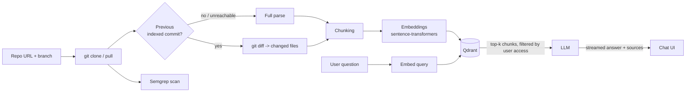
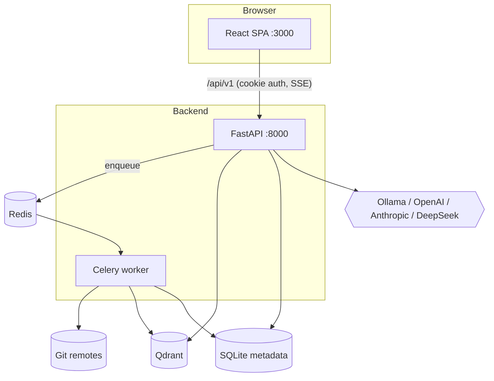

# CAISE — Codebase AI Search & Evaluation

CAISE indexes Git repositories into a vector database and lets you **search and chat with your code**. Ask
a question in natural language, CAISE retrieves the most relevant code chunks (semantic search), and an LLM of
your choice answers using only that code, citing file paths and line numbers.

- Retrieval-Augmented Generation (RAG) over your own repositories
- Per-branch indexing with **incremental re-indexing** (only changed files are re-processed)
- Multiple LLM providers: local **Ollama**, **OpenAI**, **Anthropic**, **DeepSeek**
- Streaming chat (Server-Sent Events) with persistent chat history
- GitHub OAuth login, plus a guest mode for public repositories
- Per-user access control: you only ever retrieve code from repositories you have been granted access to
- [Semgrep](https://semgrep.dev) security scan on every index run

---

## Table of contents

1. [Use cases](#use-cases)
2. [How it works](#how-it-works)
3. [Architecture](#architecture)
4. [Tech stack](#tech-stack)
5. [Repository layout](#repository-layout)
6. [Prerequisites](#prerequisites)
7. [Installation](#installation)
8. [Configuration](#configuration)
9. [Running CAISE](#running-caise)
10. [Using CAISE](#using-caise)
11. [API reference](#api-reference)
12. [Security model](#security-model)
13. [Production deployment notes](#production-deployment-notes)
14. [Troubleshooting](#troubleshooting)

---

## Use cases

| Scenario | How CAISE helps |
| --- | --- |
| **Onboarding** onto an unfamiliar codebase | "Where is authentication handled?", "How does the indexing pipeline work?" answered with file/line references |
| **Code navigation** in large repos | Semantic search finds code by meaning, not just by keyword |
| **Code review / change awareness** | Each index run records which files were modified, added and deleted since the last indexed commit |
| **Security triage** | Semgrep findings (severity, rule id, file, line) are produced on every index run |
| **Private / on-prem AI** | Run entirely locally with Ollama and an embedded or self-hosted Qdrant, so code never leaves your machine |
| **Team knowledge base** | Index several repos/branches and ask questions across all of them or scoped to one |
| **Always-fresh index** | A GitHub `push` webhook re-indexes registered branches automatically |

## How it works



1. **Ingest** – the repository is cloned (or pulled) into `caise-backend/storage/repos/<org>/<repo>@<branch>`.
   One checkout and one index exist per *repository URL + branch*; the repo id is `<url>@<branch>`.
2. **Chunk** – Python files are split by AST (tree-sitter) into function and class chunks. Other supported files
   (`.js .ts .java .go .rs .md .json`) are split into blocks of 100 lines. Symlinks are never followed.
3. **Embed** – chunks are embedded with `all-MiniLM-L6-v2` (384 dimensions, cosine distance) and stored in Qdrant
   together with the list of users allowed to see them.
4. **Incremental updates** – on later runs CAISE diffs the last indexed commit against `HEAD` and only re-embeds
   modified/added files and removes deleted ones. If the previous commit no longer exists (force-push), it falls
   back to a full re-index. If `HEAD` is unchanged, nothing is done.
5. **Ask** – the question is embedded, the top-k most similar chunks the user may access are retrieved, and the LLM
   answers from those snippets. Tokens stream back to the browser over SSE together with the sources.

> Only Python has structure-aware (AST) chunking today; every other supported file type uses fixed 100-line blocks.

## Architecture



- **FastAPI** serves the REST + SSE API, authentication, chat, and the GitHub webhook.
- **Celery + Redis** run the (slow) indexing pipeline out of band; the UI polls `/task-status/{id}`.
- **Qdrant** stores the vectors. `QDRANT_MODE=local` uses an embedded store (single process only);
  `QDRANT_MODE=server` connects to a Qdrant server. **Use `server` mode** whenever the API and the Celery worker
  run together — the embedded store is file-locked and they would collide.
- **SQLite** (`caise_metadata.db`) holds users, organizations, repository metadata, chats, and encrypted API keys.

## Tech stack

| Layer | Technology |
| --- | --- |
| Backend | Python, FastAPI, Uvicorn, SQLAlchemy, Pydantic Settings |
| Async jobs | Celery 5, Redis |
| Vector DB | Qdrant (embedded or server) |
| Embeddings | `sentence-transformers` (`all-MiniLM-L6-v2`) |
| Parsing | tree-sitter (Python AST), GitPython |
| Security scan | Semgrep |
| LLMs | Ollama (local), OpenAI, Anthropic, DeepSeek |
| Auth | GitHub OAuth, JWT in an HttpOnly cookie, Fernet-encrypted stored API keys |
| Frontend | React 19, TypeScript (strict), Vite, Tailwind CSS 4, react-router 7, react-markdown, highlight.js |

## Repository layout

```
CAISE/
├── caise-backend/
│   ├── app/
│   │   ├── main.py                 # FastAPI app, CORS, lifespan (DB init + repo-id migration)
│   │   ├── api/
│   │   │   ├── deps.py             # current-user / guest / member dependencies
│   │   │   └── v1/                 # auth, chat (SSE), keys, indexing/search/ask/webhook routers
│   │   ├── core/                   # config (env settings), celery, database, JWT, Fernet crypto
│   │   ├── models/auth_models.py   # User, Organization, RepositoryMetadata, UserApiKey, Chat, ChatMessage
│   │   ├── services/
│   │   │   ├── ingestion/          # git clone/pull, ls-remote branches, git diff
│   │   │   ├── parser/             # tree-sitter + generic chunking
│   │   │   ├── vector/             # embeddings + Qdrant store
│   │   │   ├── llm/                # provider catalog, streaming, prompts
│   │   │   ├── security/           # Semgrep scanner
│   │   │   ├── pipeline.py         # clone -> parse -> embed -> upsert
│   │   │   └── keys.py             # per-user encrypted API keys
│   │   └── workers/tasks.py        # Celery task: process_repository_pipeline
│   ├── requirements.txt
│   └── .env                        # NOT committed — see Configuration
├── caise-frontend/                 # React SPA (see caise-frontend/README.md)
├── qdrant_storage/                 # Qdrant server volume (gitignored)
└── venv/                           # Python virtualenv (gitignored)
```

## Prerequisites

| Requirement | Notes |
| --- | --- |
| Python 3.12+ | The project's virtualenv was created with Python 3.14 |
| Node.js 20+ and npm | For the frontend (Vite 8 / Tailwind 4) |
| Git | Used for cloning, `ls-remote` and `diff` |
| Redis | Celery broker/result backend (`redis-server` or Docker) |
| Qdrant | Docker container recommended (`QDRANT_MODE=server`) |
| Semgrep | Installed through `requirements.txt` (rules are fetched online with `SEMGREP_CONFIG=auto`) |
| Ollama *(optional)* | Only for local models; pull the models you want to use |
| GitHub OAuth App *(optional)* | Needed for GitHub login; guest mode works without it |

`requirements.txt` includes `torch` with CUDA wheels, so the install is large (several GB). A GPU is not required;
embeddings run on CPU.

## Installation

### 1. Clone

```bash
git clone <your-fork-or-remote-url> CAISE
cd CAISE
```

### 2. Backend

```bash
python3 -m venv venv
source venv/bin/activate
pip install -r caise-backend/requirements.txt
```

### 3. Start Redis and Qdrant

```bash
# Redis
docker run -d --name caise-redis -p 6379:6379 redis:7
# (or: redis-server)

# Qdrant (data persisted in ./qdrant_storage, which is gitignored)
docker run -d --name caise-qdrant -p 6333:6333 -p 6334:6334 \
  -v "$(pwd)/qdrant_storage:/qdrant/storage" qdrant/qdrant
```

### 4. Configure the backend

Create `caise-backend/.env` (see [Configuration](#configuration) for every option). A minimal working file:

```dotenv
ENVIRONMENT=development
SECRET_KEY=<output of: python -c "import secrets; print(secrets.token_urlsafe(48))">

FRONTEND_URL=http://localhost:3000
GITHUB_CLIENT_ID=<your OAuth app client id>
GITHUB_CLIENT_SECRET=<your OAuth app client secret>
GITHUB_REDIRECT_URI=http://localhost:8000/api/v1/auth/github/callback

CELERY_BROKER_URL=redis://localhost:6379/0
CELERY_RESULT_BACKEND=redis://localhost:6379/0

QDRANT_MODE=server
QDRANT_HOST=localhost
QDRANT_PORT=6333

DEFAULT_LLM_PROVIDER=ollama
OLLAMA_BASE_URL=http://localhost:11434
DEFAULT_LOCAL_MODEL=qwen2.5-coder:32b
```

### 5. (Optional) Local LLM with Ollama

```bash
ollama pull qwen2.5-coder:32b     # or any model listed in AVAILABLE_LOCAL_MODELS
```

Smaller alternatives: `llama3:8b`. Models offered in the UI must appear in `AVAILABLE_LOCAL_MODELS`
(or be `DEFAULT_LOCAL_MODEL`).

### 6. (Optional) GitHub OAuth App

Create one at **GitHub → Settings → Developer settings → OAuth Apps** with:

- Homepage URL: `http://localhost:3000`
- Authorization callback URL: `http://localhost:8000/api/v1/auth/github/callback`

Copy the client id/secret into `.env`. The requested scopes are `user:email,read:org` (`GITHUB_OAUTH_SCOPE`).

### 7. Frontend

```bash
cd caise-frontend
cp .env.example .env
npm install
```

`caise-frontend/.env`:

```dotenv
VITE_BACKEND_URL=http://localhost:8000   # backend the dev server proxies /api to
VITE_DEV_PORT=3000                        # must match FRONTEND_URL in the backend .env
VITE_API_PREFIX=/api/v1                   # must match API_V1_STR in the backend .env
```

## Configuration

All backend settings are read from environment variables or `caise-backend/.env`
(defined in `caise-backend/app/core/config.py`). Unknown variables are ignored.

### Core, database and storage

| Variable | Default | Description |
| --- | --- | --- |
| `PROJECT_NAME` | `CAISE` | API title |
| `ENVIRONMENT` | `development` | `production` enables secure cookies and refuses an insecure `SECRET_KEY` |
| `API_V1_STR` | `/api/v1` | API prefix |
| `DATABASE_URL` | `sqlite:///./caise_metadata.db` | Relative SQLite paths are resolved against `caise-backend/` so the API and worker share one DB |
| `STORAGE_DIR` | `caise-backend/storage/repos` | Where repositories are checked out (embedded Qdrant lives in `<STORAGE_DIR>/qdrant_db`) |

### Authentication and security

| Variable | Default | Description |
| --- | --- | --- |
| `SECRET_KEY` | *insecure placeholder* | JWT signing key. **Must** be a strong random value in production |
| `JWT_ALGORITHM` | `HS256` | |
| `ACCESS_TOKEN_EXPIRE_MINUTES` | `1440` | Session lifetime (24 h) |
| `API_KEY_ENCRYPTION_KEY` | *(empty)* | Fernet key protecting users' saved LLM keys. Empty → derived from `SECRET_KEY`. Generate with `python -c "from cryptography.fernet import Fernet; print(Fernet.generate_key().decode())"` |
| `GITHUB_CLIENT_ID` / `GITHUB_CLIENT_SECRET` | *(empty)* | GitHub OAuth app credentials |
| `GITHUB_REDIRECT_URI` | `http://localhost:8000/api/v1/auth/github/callback` | Must equal the callback URL registered on GitHub |
| `GITHUB_OAUTH_SCOPE` | `user:email,read:org` | |
| `FRONTEND_URL` | `http://localhost:3000` | The only allowed CORS origin and the post-login redirect target |
| `FRONTEND_POST_LOGIN_PATH` | `/dashboard` | |
| `GUEST_ALLOWED_HOSTS` | `github.com` | Hosts guests may index (public repos only) |
| `GITHUB_WEBHOOK_SECRET` | *(empty)* | HMAC secret for `/github-webhook`; the endpoint rejects everything while empty |

### Celery, Qdrant, scanner, embeddings

| Variable | Default | Description |
| --- | --- | --- |
| `CELERY_BROKER_URL` / `CELERY_RESULT_BACKEND` | `redis://localhost:6379/0` | |
| `QDRANT_MODE` | `local` | `local` (embedded, single process) or `server` |
| `QDRANT_HOST` / `QDRANT_PORT` / `QDRANT_API_KEY` | `localhost` / `6333` / *(empty)* | Used in `server` mode |
| `QDRANT_COLLECTION` | `code_chunks` | |
| `SEMGREP_CONFIG` | `auto` | Passed to `semgrep scan --config` |
| `EMBEDDING_MODEL` | `all-MiniLM-L6-v2` | |
| `EMBEDDING_DIM` | `384` | Must match the model's output size. Changing the model requires a new collection / re-index |

### LLM providers

| Variable | Default | Description |
| --- | --- | --- |
| `DEFAULT_LLM_PROVIDER` | `ollama` | `ollama`, `openai`, `anthropic` or `deepseek` |
| `LLM_TEMPERATURE` | `0.1` | Not sent to Anthropic (SDK 2.x rejects it) |
| `LLM_MAX_TOKENS` | `4096` | |
| `LLM_TIMEOUT_SECONDS` | `120` | Per-read timeout, bounding the gap between streamed chunks |
| `OLLAMA_BASE_URL` | `http://localhost:11434` | |
| `DEFAULT_LOCAL_MODEL` / `AVAILABLE_LOCAL_MODELS` | `qwen2.5-coder:32b` / `qwen2.5-coder:32b,llama3:8b,deepseek-r1:32b` | |
| `OPENAI_API_KEY` / `OPENAI_MODEL` / `AVAILABLE_OPENAI_MODELS` | – / `gpt-4o` / `gpt-4o,gpt-4o-mini` | |
| `ANTHROPIC_API_KEY` / `ANTHROPIC_MODEL` / `AVAILABLE_ANTHROPIC_MODELS` | – / `claude-3-5-sonnet-20241022` / `…sonnet…,claude-3-5-haiku-20241022` | |
| `DEEPSEEK_API_KEY` / `DEEPSEEK_MODEL` / `AVAILABLE_DEEPSEEK_MODELS` / `DEEPSEEK_BASE_URL` | – / `deepseek-chat` / `deepseek-chat,deepseek-reasoner` / `https://api.deepseek.com` | |

Cloud provider keys can be set server-wide in `.env`, **or** each signed-in user can save their own in
**Settings** (stored encrypted, never returned in full). A user's own key takes precedence for that user.

### Frontend (`caise-frontend/.env`)

| Variable | Description |
| --- | --- |
| `VITE_BACKEND_URL` | Backend the dev/preview server proxies `/api` to (required) |
| `VITE_DEV_PORT` | Dev/preview port (required; strict) |
| `VITE_API_PREFIX` | API prefix; must match `API_V1_STR` |

## Running CAISE

Run each process in its own terminal (venv active for the backend ones).

```bash
# 1. API  (from caise-backend/)
cd caise-backend
uvicorn app.main:app --reload --port 8000

# 2. Indexing worker  (from caise-backend/)
cd caise-backend
celery -A app.core.celery.celery_app worker --loglevel=info

# 3. Frontend  (from caise-frontend/)
cd caise-frontend
npm run dev
```

Then open <http://localhost:3000>. Interactive API docs: <http://localhost:8000/docs>.

> Run the backend commands from `caise-backend/` — `.env` and the relative SQLite path are resolved from there.
> The first index/search loads the embedding model, which downloads it once from Hugging Face.

Frontend production build:

```bash
cd caise-frontend
npm run build      # typechecks, then bundles to dist/
npm run preview
```

## Using CAISE

1. **Sign in** with GitHub, or choose **Continue without signing in** for a guest session (public `github.com`
   repositories only, no stored API keys, no Settings page).
2. **Add a repository** on the Dashboard: enter the repo URL, load its branches, pick one, and start indexing.
   For private repos supply a GitHub token — it is used for that run only and **never stored**.
   Indexing progress is shown as a job card; once `indexed`, the repo is searchable.
3. **Chat** in the Workspace: pick a repository (or search across all you can access), choose a provider/model,
   and ask. Answers stream in with source snippets. The **context drawer** shows the files analysed and the last
   index's modified/added/deleted files.
4. **Re-index** a repo any time; unchanged commits are skipped and changed commits are indexed incrementally.
5. **Settings** (GitHub users): save your own OpenAI / Anthropic / DeepSeek API keys.
6. **Auto-index on push**: add a webhook in your GitHub repo — payload URL
   `https://<host>/api/v1/github-webhook`, content type `application/json`, secret = `GITHUB_WEBHOOK_SECRET`,
   event **push**. Only already-registered `repo@branch` pairs are re-indexed.

### Example: calling the API directly

All endpoints require a session cookie (`access_token`) or an `Authorization: Bearer <jwt>` header.

```bash
# guest session (cookie jar)
curl -c jar -X POST http://localhost:8000/api/v1/auth/guest

# queue indexing
curl -b jar -X POST http://localhost:8000/api/v1/index-repo-async \
  -H 'Content-Type: application/json' \
  -d '{"repo_url":"https://github.com/tiangolo/fastapi","branch":"master"}'

# poll the task
curl -b jar http://localhost:8000/api/v1/task-status/<task_id>

# stream a chat answer (SSE)
curl -N -b jar -X POST http://localhost:8000/api/v1/chat/stream \
  -H 'Content-Type: application/json' \
  -d '{"prompt":"How are dependencies resolved?","repo_id":"https://github.com/tiangolo/fastapi@master","provider":"ollama"}'
```

## API reference

Base path `/api/v1`. Full schema at `/docs` (Swagger) and `/api/v1/openapi.json`.

| Method & path | Auth | Purpose |
| --- | --- | --- |
| `GET /auth/github` | – | Redirect to GitHub OAuth |
| `GET /auth/github/callback` | – | OAuth callback; sets the session cookie, redirects to the frontend |
| `POST /auth/guest` | – | Start a guest session |
| `GET /auth/me` | user | Current user |
| `POST /auth/logout` | – | Clear the session cookie |
| `POST /index-repo-async` | user | Queue indexing of `{repo_url, branch, access_token?}` |
| `GET /task-status/{task_id}` | user | Celery task state and result |
| `GET /repos` | user | Repositories the caller can access, with status and last-change summary |
| `POST /repos/branches` | user | Remote branches + which are already indexed |
| `GET /repos/files?repo_id=` | user | Indexed files and chunk counts |
| `DELETE /repos?repo_id=` | owner | Delete index, checkout and metadata |
| `POST /search` | user | Semantic search: `{query, repo_id?, limit}` |
| `POST /ask` | user | Non-streaming RAG answer with sources |
| `POST /chat/stream` | user | Streaming chat (SSE: `chat`, `start`, `sources`, `token`…, `done` / `error`) |
| `GET /chats`, `GET /chats/{id}`, `DELETE /chats/{id}` | user | Stored chat history |
| `GET /models` | optional | Provider/model catalog with `configured` flags |
| `GET /llm/models` | – | Legacy provider/local-model list |
| `GET /me/keys`, `PUT /me/keys/{provider}`, `DELETE /me/keys/{provider}` | GitHub user | Manage saved provider keys |
| `POST /github-webhook` | HMAC | Re-index on `push` |
| `GET /health` | – | Liveness |

Chat history sent to the model is rebuilt server-side from the last 20 stored messages; failed turns are omitted.
Failures before the first token return a real HTTP status (e.g. `503 provider_not_configured`, `502 provider_auth_failed`,
`429 provider_rate_limited`, `504 provider_timeout`); failures mid-stream arrive as an SSE `error` event.

## Security model

- **Access control** – every Qdrant point stores `allowed_users`; all searches filter on the caller's id. A user is
  added to a repository only after a clone/pull succeeds with *their* credentials.
- **Sessions** – JWT in an HttpOnly, `SameSite=Lax` cookie (`Secure` in production). CORS allows only `FRONTEND_URL`.
- **Secrets** – GitHub tokens for private repos are used per run only and are stripped from `.git/config` afterwards.
  Saved LLM keys are Fernet-encrypted; only a 4-character hint is ever returned.
- **Guests** – public repos on `GUEST_ALLOWED_HOSTS` only, no credentials, no key storage.
- **Input hardening** – repository URLs and git refs are allow-list validated (no option injection, `..`, or shell
  metacharacters); git is invoked without a shell; symlinks are not followed during parsing.
- **Webhook** – HMAC-SHA256 signature verified in constant time; disabled while no secret is set.
- **Provider errors** – upstream error text is never forwarded to clients because it can echo credentials.

## Production deployment notes

- Set `ENVIRONMENT=production` and a strong `SECRET_KEY` (startup fails otherwise); set a dedicated
  `API_KEY_ENCRYPTION_KEY`. Rotating either makes previously saved user keys unreadable.
- Serve the built frontend and `/api` from **one origin** behind a reverse proxy (TLS required for `Secure` cookies).
  For SSE, disable proxy buffering (the API already sends `X-Accel-Buffering: no`).
- Use `QDRANT_MODE=server`, and a Redis instance reachable by both the API and the worker.
- Update `GITHUB_REDIRECT_URI`, `FRONTEND_URL`, and the OAuth app's callback to your public URLs.
- Back up `caise_metadata.db` and the Qdrant volume. SQLite is suitable for a single node; point `DATABASE_URL`
  at another SQLAlchemy-supported database for more.

## Troubleshooting

| Symptom | Cause / fix |
| --- | --- |
| `Storage folder is already accessed by another instance of Qdrant client` | Embedded Qdrant allows one process. Set `QDRANT_MODE=server` and run Qdrant in Docker |
| Indexing stays `queued`/`pending` | Redis is down or no Celery worker is running |
| `SECRET_KEY must be set…` at startup | `ENVIRONMENT=production` with a placeholder key |
| CORS or login redirect loops | `FRONTEND_URL` (backend) must equal the dev origin, i.e. `http://localhost:<VITE_DEV_PORT>` |
| `VITE_BACKEND_URL is not set` | Create `caise-frontend/.env` from `.env.example` |
| `provider_not_configured` (503) | No server key and no saved user key for that cloud provider |
| `provider_unreachable` with Ollama | Ollama isn't running or `OLLAMA_BASE_URL` is wrong; ensure the model is pulled |
| "Model … is not available for provider …" | Add the model to the matching `AVAILABLE_*_MODELS` variable |
| Search returns nothing | Repo not yet `indexed`, or you lack access, or the file types aren't in the supported set |
| Semgrep finds nothing / fails | `SEMGREP_CONFIG=auto` needs network access to fetch rules; failures are logged and yield no findings |
| Webhook returns 401 | `GITHUB_WEBHOOK_SECRET` empty or doesn't match the secret configured on GitHub |

## Limitations

- AST-aware chunking is Python-only; other languages use fixed-size blocks.
- Supported file types: `.py .js .ts .java .go .rs .md .json`.
- Only `http(s)` Git remotes are supported.
- The Semgrep findings are returned in the indexing task result; they are not persisted or shown elsewhere.
- No automated test suite is included yet.

## License

No license file is present in this repository; add one before distributing.
